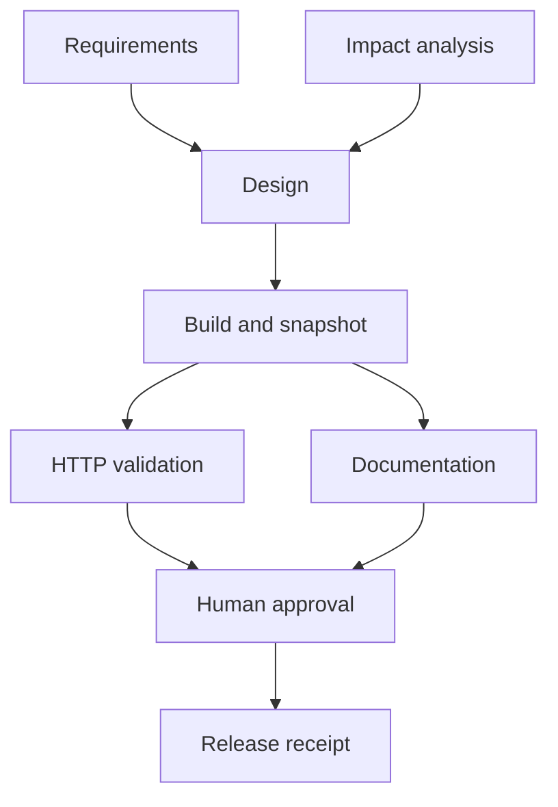

# Architecture and engineering summary

- **Service.** Spring MVC LinkController handles HTTP and delegates to LinkStore. LinkStore serializes
  mutations within a process, holds an exclusive file lock across processes,
  and atomically replaces the local data file. Rows contain code, Base64
  destination, click count, and expiration epoch second. Missing legacy
  count and expiration fields default to zero. A zero expiration is perpetual.
- **Workflow.** A dependency map and persisted stage states determine
  readiness. A two-worker executor runs independent stages. The runner waits
  for each batch and downstream stages require all their dependencies to
  exit successfully. Clarification and release approval are operator gates.
- **Lineage.** State records the revision, stage status, and revision that
  owns any reused output. Each implementation stage copies source and
  requirements into a revision directory and uses Maven to build a runnable
  Spring Boot JAR with embedded Tomcat. The
  testing stage launches the JAR in isolated temporary storage and runs
  real HTTP requests. The release gate verifies the approved source digest
  and the validated JAR digest. A change to the checkout
  triggers selective re-planning and a fresh review.
- **Recovery.** The release exercise allows two attempts, a review-only
  fallback, and rollback of a changed local release receipt. Fault injection
  is explicit. Unexpected stage failures stop the run and preserve evidence.
- **Policy.** The service binds to loopback, only accepts HTTP(S) destinations,
  bounds URL and TTL inputs, and stores aggregate counts. Release actions
  are limited to local files. The operator ID is captured in the decision
  and receipt. The workflow runs a fixed set of stage actions.
- **Observability.** Each run writes a tab-separated event trace with a UTC
  timestamp, revision, actor, action, and detail. Metrics summarize terminal
  revisions, retry and rollback counts, mean time to recover for observed
  recoveries, and mean wall-clock time from revision start to terminal
  outcome. The latter includes operator wait. Revisions awaiting review
  or superseded before completion do not enter the success-rate denominator.

## Validation and trade-offs

The service suite exercises input rejection, redirect headers, analytics,
legacy schema compatibility, expiry, and restart persistence. The workflow
suite exercises the parallel fork, persisted resumption, approval and
denial, both kinds of re-planning, retry, rollback, fallback, and metrics.

The workflow runner is a separate Java CLI with deterministic, scenario-specific stage actions. The
implementation stage builds prewritten source and the clarification
changes a validation input. Live LLM generation and arbitrary requirements
are outside the prototype. Release publishes a receipt and rollback
restores that receipt. A production implementation would need deployment
integration, authenticated approvals, and an external immutable audit sink.
The local trace and state use separate writes, so a process crash can leave
a trace gap. Local filesystem permissions are the trust boundary.

Each click rewrites the link file. This favors a small local
demonstration over high write throughput. A shared transactional store,
abuse protection, and authenticated administration would be required for
a public service. The prototype has been exercised with Java 21 on Linux.

## Verified results

| Command | Result |
|---|---|
| mvn clean package | Builds the Spring Boot JAR and runs the Spring MVC tests |
| java tools/ServiceTest.java | Exercises the packaged service over HTTP |
| java tools/WorkflowTest.java | Exercises orchestration and scenario validation against each built JAR |
